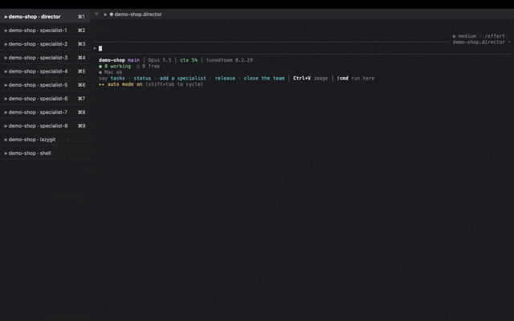

# Tuned Team

Run 2-10 tickets at once with a team of Claude Code sessions: a director you talk to and
specialists that each take a ticket to a merged branch.

- **director**: the only one you talk to. Turns what you want into tickets, hands them to
  the specialists, keeps order between them, handles handoffs and releases.
- **specialists**: each takes one ticket (code, design, copy, research) on its own branch
  and worktree, and is done when that branch is merged.



A scripted demo on a made-up project, in iTerm2 with the tunedteam layout: one tab per agent, listed on the left.

## Subagents or Tuned Team?

They do different jobs.

- A **subagent** is a one-shot helper inside one Claude Code session: it gets one task,
  reports back and ends. It shares the parent session's context budget, and you don't talk to it.
- A **specialist** is a full, long-lived Claude Code session with its own context, on its own
  branch, and its work ends merged. You can open its tab and talk to it.
- The **director** keeps order: who takes which ticket, handoffs between specialists, checks
  before merge, and the release.

Tools that shape how one piece of work gets done, such as superpowers (brainstorm, plan,
execute with subagents), work inside a specialist's ticket. Layers, not competitors: Tuned Team
runs many tickets side by side; such a tool runs one ticket well.

Two levels on purpose: following Anthropic's "Building effective agents" (start simple,
add a layer only when it measurably helps), and an earlier measurement where a middle
layer of managers cost 2-3x the tokens per commit for about 14% more commits.

## Install

```sh
brew install zdzislawbela/tap/tunedteam
```

Homebrew brings tmux along. Claude Code is installed separately
(`brew install --cask claude-code`). Update with `brew upgrade tunedteam`; what each version
brings is in [CHANGELOG.md](CHANGELOG.md). Works in any
terminal (Ghostty, iTerm2, Terminal).

New to tmux? Use **iTerm2** (`brew install --cask iterm2`): every agent is a normal tab you
click, listed on the left, and no tmux keys to learn. The first start in iTerm2 offers this
layout. It also raises iTerm2's "Don't open windows when attaching if there are at least this many
windows" from 10 to 50: a team has 12 windows or more, and below that limit iTerm2 opened no tab, only its tmux Dashboard.

To work on Tuned Team itself instead: clone this repo and run `./install.sh`, which links
`bin/tunedteam` into `~/bin` (needs `tmux`, `claude`, `python3`, `git`).

## Several repos in one team (e.g. a UI and its backend)

At start, after the account, `tunedteam` asks "Connect other repos to this team?". Say yes and tick
the other repos (Space ticks, Enter confirms); the list holds the repos found in `~/repos` (a few
levels deep) and "Other folder…". The answer is remembered per project. Start the team in the repo
you work on most: a frontend developer starts in the UI repo and connects the backend, a backend
developer starts in the backend and connects the UI.

Every agent can then read and change the connected repos (`claude --add-dir`), creates worktrees
in them with `tunedteam worktree --repo <path> <branch>`, and `close-all` checks all of them for
unmerged work. How to run each repo locally belongs in that repo's CLAUDE.md or README: the agents
read it. Something only one copy can run on the Mac (a docker compose stack, a database) gets one
owner at a time, named by the director.

## Two Claude accounts (e.g. work and private)

Claude Code keeps an account in a config folder: `~/.claude` by default, any other
folder through `CLAUDE_CONFIG_DIR`. One-time setup of a second account:

```sh
CLAUDE_CONFIG_DIR=~/.claude-priv claude
```

Log in inside it (`/login`, pick the private account), then exit. From then on
`tunedteam` lists both accounts at start with their email and plan, and remembers
your choice per project. Name extra folders `~/.claude-<something>` and they are found
on their own.

Optional, so plain `claude` in a terminal also picks the right account by folder
(in `~/.zshrc`):

```sh
autoload -U add-zsh-hook
_claude_profile() {
  if [[ $PWD == $HOME/repos/priv* ]]; then export CLAUDE_CONFIG_DIR=$HOME/.claude-priv
  else unset CLAUDE_CONFIG_DIR; fi
}
add-zsh-hook chpwd _claude_profile; _claude_profile
```

## Database and deploy tools (MCP)

At start you choose how agents may use database and deploy tools from your MCP servers
(Supabase, Neon, Vercel and others):

- **ask** (default, the safe choice): agents read freely; every tool that writes, migrates,
  deploys or deletes (`execute_*`, `apply_*`, `run_sql*`, `deploy_*`, `delete_*`, `drop_*`,
  `insert_*`, branch merge/reset/rebase, on any server) is on Claude Code's ask list, so you
  approve each call in that window. This holds in auto mode too. Agents also save the change
  as a file in the repo and show you the exact SQL first.
- **full**: agents really do everything on their own, without asking: writes, migrations,
  deploys, deletes. Your job is to point the team at **staging**, never production: the
  database and deploy target the team works on is treated as staging, whatever its name.
  Before SQL that changes data, agents take a backup (or write down the SQL that restores
  it); after it, they run the tests. At start, picking full shows this and asks you to confirm.

If your MCP server has a read-only mode (Supabase does), connect it read-only for the team.

## Paid API key vs subscription

With `ANTHROPIC_API_KEY` in the environment, Claude Code may bill the API instead of
your Max or Pro plan. On an account with a subscription, every Tuned Team window starts
without that variable, so the windows run on the plan and the agents' commands cannot
pick the key up. `tunedteam` also warns at start when it finds the key in your shell or
in the project's `.env*` files, and the team rules tell agents to run their own AI work
(tests, scoring, simulations) through `claude -p` or subagents, and the paid API only with
your yes. Project scripts that read the key from `.env.local` themselves are outside
Tuned Team's reach: block them in the project (see your AGENTS.md).

## Use

Anywhere:

```sh
tunedteam
```

The first question is the project folder: the current one (if it is a git repo), then
projects you ran a team in, then repos in `~/repos`, or any folder you type.

Every question is a list you pick from with the arrow keys and Enter. It lists your Claude accounts (`~/.claude`, every `~/.claude-*` folder and your own
`CLAUDE_CONFIG_DIR`, e.g. work and private), asks which one to use (with one account it
skips the question) and logs it in first if needed, so no window opens on a
logged-out account. Then it asks for the number of specialists, the model, who decides on push
and release, whether to read notifications or only questions aloud, and what the team does
when it has nothing to do (see below). The director
answers in the language you write in; agents write to each other in English. Then the tabs open and you talk to the director (tab 0). The last tab, `shell · last resort`,
is a plain terminal for you in the project folder, for when you have to type something yourself.
With [lazygit](https://github.com/jesseduffield/lazygit) installed, the tab before it shows the repo in lazygit.
Tabs of your own go in `~/.tunedteam/tabs`, one per line as `name: command` (e.g. `awake: caffeinate -d`):
each opens as a shell with the command typed in, so your aliases work.
All names are in English (`director`, `specialist-N`, `shell`): they are the tab names and
the names commands take. Agents write to each other at `<team>.<name>` (e.g. `myapp.director`),
so teams in different projects never mix; `tunedteam teams` lists the running teams. The team
is named after the project folder; a second project with the same folder name gets `-2`.

Tabs can be clicked. tmux keys: `Ctrl-b w` all windows, `Ctrl-b c` one more terminal of your own, `Ctrl-b 0` the director, `Ctrl-b n` / `p` next / previous,
`Ctrl-b d` detach (the team keeps running; `tunedteam` again attaches).

In **iTerm2** the first start asks for the layout: the tunedteam setup (every agent a native
iTerm2 tab, listed on the left), tabs on top, or leave iTerm2 as it is. The first two change
iTerm2's settings (tmux windows open as tabs, tab bar location, the tmux gateway tab hidden) and
work from the next start; "leave it" is remembered and not asked again. Other terminals show
the tmux tab bar at the bottom.

Every window shows the same right half: `repo version branch │ model │ ctx % │ tunedteam version`,
the context turning yellow and red as the window nears its restart point (director ~20%,
specialists ~30%). On the left a specialist shows its name and task. The director has it as the
top line, then how the team is doing (`● 6 working  ○ 3 free`, plus `▲ 2 WAITING FOR YOU` when
anyone waits on you), redrawn every 15 s; below it a line about the Mac: a grey `● Mac ok`, or only what needs you,
with what to do (`▲ 5 dev servers (limit 4): stop 1`, `▲ RAM 44/48 GB, swap 3.2 GB: close a
window`, `▲ CPU 160%`), measured at most every 10 s; and at the bottom what you can say to it
("tasks", "status", "add a specialist", "release", "close the team"). Put a command in `~/.tunedteam/statusline` to show its first
line there too, e.g. deploys on Vercel: it runs in the project folder, in the background, every
5 minutes.

## Rules

The full rules are in [roles/](roles/): `team.md` for everyone, `director.md`, `specialist.md`.
Some are enforced by tunedteam, the rest are instructions the agents follow:

| Rule | Enforced by |
|---|---|
| a task ends merged, with its worktree and branch gone, before the window starts fresh | `tunedteam done` refuses until then |
| at most 2 full checks at a time | `tunedteam check` waits or exits 3 |
| database writes, migrations and deploys through MCP need your yes ("ask" mode) | Claude Code's ask list |
| nothing closes while work is unmerged | `close-all` needs `--force` |
| a window starts fresh past its restart point (director ~20%, specialists ~30%) | a hook tells the window when it passes it (the model can't see its own status line); the restart itself is done by the agent |
| one task per specialist, one branch per task, every task on its own files | the role |
| at most 4 dev servers, headless browsers | the role |
| when the team decides, at most one release an hour | the role (a hard limit belongs in the project's own release script) |
| messages only when the receiver must act, no "ok" or "thanks" | the role |
| nobody holds a blocked task: after about a minute without your answer, or after "goodnight", the task is parked and the specialist takes other work; your questions wait for you in one list | the role, `tunedteam park` |
| no specialist waits for you: questions go to the director, who decides; what only you can give comes in one message, with a fix that stops it coming back | the role, `tunedteam allow` |

## When there is nothing to do

The last question at start: wait for your tasks (the default), or **test and fix**. In test and fix, the
director gives free specialists a sweep each (UI screens, behavior and edge cases, API, performance,
architecture). A sweep fixes nothing: every problem goes to `tunedteam findings`. Open findings go out as
fix tasks, most severe first, and the split follows the queue: under 3 open, the free specialists sweep;
3 to 10, at most one sweeps; over 10, everybody fixes. A finding that needs the architecture changed comes
to you as one decision. Sweeps use your plan while you are away: pick it when you want that.

## Releases

Who pushes and releases is the third question at start: you (the default) or the team. When the
team decides, the director releases at most once an hour, all merged commits together: every
release is a deploy, and a release per merge fills the hosting's deployment storage.

## Scheduled commands

Commands to run every day go to launchd, not to a Claude session: no tokens, and they keep
running with the team closed or the Mac restarted. The first start offers to update Claude Code
every morning when it came from Homebrew.

```sh
tunedteam schedule                                        # list: when, on/off, last run, exit code
tunedteam schedule add claude-update 07:00 brew upgrade --cask claude-code
tunedteam schedule run|log|off|on|rm claude-update
```

Each runs in a login shell (your PATH), its output in `~/.tunedteam/schedule/NAME.log`. The
director uses the same command when you ask for something recurring.

## Commands the agents use

| Command | What it does |
|---|---|
| `tunedteam --version` | the installed version (in a git checkout also commits past the release) |
| `tunedteam tasks` | the tasks in progress, with the specialists, branch, ETA and state of each |
| `tunedteam log [NAME] [-n N] [-f]` | the windows' last tool calls, oldest first (all, or one window; `-f` keeps printing new ones): what each agent ran, edited, read and sent. One file per window in `~/.tunedteam/teams/<repo>/log/`, at most ~10 MB each |
| `tunedteam schedule …` | commands run every day by launchd: list, add, run, log, off, on, rm |
| `tunedteam --inside-out` | how it works under the hood and why, also in [INSIDE-OUT.md](INSIDE-OUT.md) |
| `tunedteam status` | team table: who works, who waits for the owner, context, RAM, ETA |
| `tunedteam report start\|eta\|done` | a specialist writes its state into the table |
| `tunedteam allow [RULE.. \| --env TEXT]` | permission rules (e.g. `'Bash(npm run dev*)'`) or a note for auto mode's classifier (`--env "QA is the team's staging"`) for every window of the team, so a block does not come back; each window picks it up when it starts fresh. Every window already tells auto mode that it is part of a team and which repos are yours. No arguments: list |
| `tunedteam findings [add TEXT \| take ID \| close ID [NOTE]]` | the team's queue of problems found: specialists add what they find outside their task, the director gives open ones as fix tasks. No arguments: list. `tunedteam status` shows how many are open |
| `tunedteam park "WAITS FOR"` / `unpark N` | a blocked task is put aside, not held: its branch and worktree stay, it goes on the parked list in `tunedteam tasks`, and the window takes other work; `unpark N` takes it back |
| `tunedteam worktree [--repo PATH] BRANCH [BASE]` | new branch + worktree in `<repo>-worktrees.noindex/` next to the repo (`--repo`: a connected repo) (Spotlight skips `.noindex` folders), node_modules cloned, .env.local linked to the main checkout's |
| `tunedteam owner-run < commands` | saves commands the owner has to run as a script and prints one string without spaces in the project folder (`~/repos/myapp/.run/7`, kept out of git): double-click it, copy, paste into the shell tab or after `!` in a window |
| `tunedteam check [--timeout S] [--force] CMD` | runs the full check once one of the 2 machine slots is free (exit 3: no slot, nothing ran); skips it when the same command already passed on the same clean tree (`--force` runs it) |
| `tunedteam done` | task merged: the window restarts with a fresh context; refuses while the task's worktree or branch is still there |
| `tunedteam add` | opens one more specialist |
| `tunedteam restart NAME\|self` | restarts a window with a fresh context |
| `tunedteam close-all [--force]` | lists unmerged work; with none (or `--force`) closes every window |

`statusline` and `speak` are Claude Code hooks; they are passed to each window with
`claude --settings`, so your own `settings.json` stays untouched.

## Compared with other tools

How Tuned Team differs from tools people use to run many coding agents. Mostly an
opinion from reading the tools' pages and reviews (October 2026), not a benchmark.
Only the Tuned Team and VS Code memory figures were measured, on a 48 GB M4 Pro.

| Tool | What it is | Who splits the work | Each task isolated | 16 agents on one laptop | Notes |
|---|---|---|---|---|---|
| **Tuned Team** | terminal (tmux), one command | the agents: the director hands out and checks the work; you talk only to the director | git worktree per task | yes: a fresh session uses ~370 MB (measured), so 16 are roughly 6-10 GB; should fit a 16 GB MacBook Air, not tested there | roles, quality gate before merge, machine limits (2 checks, 4 dev servers), read-aloud |
| Claude Squad | terminal (tmux) with a session switcher | you: you prompt each agent and review each diff | git worktree per session | likely yes, same tmux model | session manager, no coordination between agents; AGPL-3.0 |
| Claude Code agent teams | built into Claude Code, experimental | a lead agent | worktree support | likely yes, panes need tmux or iTerm2 | off by default; more tokens than subagents |
| VS Code + Claude Code panels | Electron editor | you | your own scripts | **no** in our use: at 8-10 long sessions the window froze (one renderer process at 1.4 GB and 100% of one core, measured) | every panel is drawn by one window process |
| Cursor 3 (Agents Window) | Electron editor (VS Code fork) | you | worktree per agent | up to 8 agents per window (vendor) | same Electron model as VS Code; paid plans |
| OpenAI Codex app | desktop app | you | built-in worktrees | not known | another model and plan |
| Conductor | Mac app | you | worktree per workspace | 5-10 sessions (reviews) | GUI around worktrees: chat, diff, checks, PR |
| workmux, dmux | small terminal tools | you | worktree per task | likely yes | windows and worktrees only |

In short: the window-and-worktree layer is the same everywhere (tmux or an app around
git worktrees). What Tuned Team adds is the coordination: agents hand out and check the
work, so one person can run 16 of them without switching between windows.

## How it works

- Roles: `roles/team.md` (rules for everyone) plus `roles/director.md` or
  `roles/specialist.md`, passed with `--append-system-prompt-file`.
- The director's handover before a fresh start goes to `~/.tunedteam/teams/<repo>/handover.md`.
- State per team: `~/.tunedteam/teams/<repo>/` (answers, reports, generated prompts and settings).
- Every agent is a Claude Code session in its own tmux window, so the team keeps running when you
  close the terminal. tmux is an implementation detail: any terminal multiplexer would do.
- tmux runs its own server (`tmux -L tuned`) with `tmux.conf` from this repo, so your own tmux is untouched.
- Every window starts in auto mode. Speaking aloud uses macOS `say`, with a Polish voice
for text with Polish letters.

## What it costs

Tuned Team saves your time, not tokens. Measured on our own teams (October 2026, not a benchmark),
against one Claude Code session doing the same kind of tasks one after another:

- about 2x the output tokens and 1.4x the input tokens per changed line of code;
- in return, several tasks at once: 3 on average, 15 at the peak.

The extra goes on coordination: every message wakes its receiver over its whole context, and the
director reads the reports. The rules keep it down: messages only when the receiver must act, no
acknowledgements, and a check that already passed on the same tree is not run again.

To use less of your plan: Sonnet for the specialists (asked at start), fewer specialists, and a
plain session for a single small task.

## When not to use it

- One small task: a plain Claude Code session does it for less.
- Tasks that all change the same files: they wait for each other anyway.
- A project with no tests or checks: specialists merge on green, and with nothing to check,
  green says little.

## Limits

One laptop runs at most 2 full checks and 4 dev servers at a time, whatever the team size.
Each window is a full Claude Code session: many windows use memory and your plan's usage limits.

## License

MIT, see [LICENSE](LICENSE).
